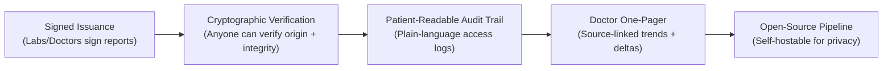

# MediChain AI — Deep Analysis Report

> **Source:** [MediChain_AI_Blueprint.pdf](file:///D:/Medichain/MediChain_AI_Blueprint.pdf) (44 pages, v1.0, 7 Nov 2026)
> **Analysis Date:** 8 November 2026

---

## 1. What Is MediChain AI?

A **hybrid Web2 + AI + Web3** platform where:
- **Patients** hold a unified, verifiable medical history
- **AI** converts uploaded reports into structured, comparable data
- **Blockchain** anchors document fingerprints to prove integrity (tamper evidence)

> [!IMPORTANT]
> The recommended **product wedge** is **verifiable health documents** — not "yet another PHR." Government (Aarogya Setu 2.0) and Eka Care already offer free PHR + AI summaries. Storage + AI summaries are **table stakes**.

---

## 2. Five Critical Findings

| # | Finding | Implication |
|---|---------|-------------|
| 1 | **Market moved** — Aarogya Setu 2.0 launched Jun 2026 with AI insights, Gemma 4, FHIR extraction | "Unified records + AI summary" is commoditized. Cannot be the differentiator. |
| 2 | **ABDM at scale** — 96 crore ABHA numbers, 100+ crore records linked | Must interoperate (ABHA M1, M3), not compete |
| 3 | **Blockchain = narrow value** — Hash anchoring = real; on-chain permissions = theatre | Use chain ONLY for tamper evidence + issuer registry |
| 4 | **Privacy dictates tech choices** — Free-tier LLMs may train on prompts | NEVER send real patient data to free APIs; synthetic only for hackathon |
| 5 | **Regulation is imminent** — DPDP consent manager provisions start 13 Nov 2026; main obligations 13 May 2027 | Build compliance (consent records, audit logs, breach response) from Day 1 |

---

## 3. True Differentiators (What Nobody Else Does)

| Differentiator | vs Aarogya Setu 2.0 | vs Eka Care | vs Practo |
|---|---|---|---|
| **Cryptographic report authenticity** | Not documented | Not documented | No |
| **Patient-readable access log** | Consent-based; log UX undocumented | Not documented | No |
| **Doctor one-page trend summary** | AI insights, not cross-provider synthesis | EMR-focused | EMR-focused |
| **Open-source extraction pipeline** | Uses open tools but not self-hostable by users | Proprietary | Proprietary |

---

## 4. Target Users & Core Needs

| Persona | Profile | Top Need |
|---------|---------|----------|
| **Asha (Patient)** | 44, Type-2 diabetes, reports from 3 labs over 6 years | See HbA1c trend; share selectively; know who looked |
| **Dr. Rao (GP)** | Private clinic, 40 patients/day | One-page summary with deltas; verify report authenticity |
| **City Diagnostics (Lab)** | Mid-size, exports PDFs | Issue verifiable reports; reduce "is this real?" calls |
| **Admin (Platform)** | Trust & safety | Verify institutions; review suspicious access |

---

## 5. Market Landscape

### 5.1 India Digital Health Backbone
- **96 crore** ABHA numbers (Aug 2026)
- **100+ crore** health records linked (May 2026)
- **5.47 lakh** registered facilities
- **450+** integrated health-tech solutions
- **Aarogya Setu 2.0** — Government PHR with AI, launched Jun 2026

### 5.2 Key Competitors

| Player | Strength | Weakness/Gap |
|--------|----------|-------------|
| **ABDM / Aarogya Setu 2.0** | 96cr reach, free, AI insights, Gemma 4 | Authenticity/access-log UX undocumented |
| **Eka Care** | Mature, ABDM-approved, developer APIs | Document recognition needs improvement |
| **HealthPlix** | 10,000+ doctors, multilingual Rx | Doctor-side only, no patient vault |
| **Practo** | Marketplace + SaaS, doctor discovery | Data locked in Practo's ecosystem |
| **Apple Health** | Strong on-device privacy | Weak Indian lab ecosystem |

### 5.3 Commercial Opportunities

| Model | Payer | Fit |
|-------|-------|-----|
| Free patient app + paid clinic subscription | Doctors/clinics | **Strong** — proven in India (Eka ₹16,999-₹1L/yr) |
| Verified-report issuance for labs | Diagnostic centres | **Promising** — needs lab pilots |
| Verification API for insurers | Insurers, TPAs | Later — large compliance burden |
| Patient premium (family vaults) | Patients | Weak alone — consumers expect free PHRs |

---

## 6. Technology Stack Assessment

### 6.1 Recommended Stack (Final)

| Layer | Technology | Notes |
|-------|-----------|-------|
| **Frontend** | Next.js (App Router) + TypeScript + Tailwind + shadcn/ui + Recharts + TanStack Query | Types generated from OpenAPI |
| **Backend API** | FastAPI + Pydantic v2 + SQLAlchemy 2 (async) + Alembic | Single authorization layer |
| **Worker** | FastAPI BackgroundTasks → Arq/RQ + Redis later | OCR and AI jobs |
| **Database** | Supabase Postgres + pgvector + Supabase Storage | RLS on, encrypted blobs |
| **AI** | pdfplumber/pypdfium2 → PaddleOCR → Gemini Flash (demo) / Gemma 4 (real) | Schema-constrained JSON output |
| **Blockchain** | Solidity ^0.8.x + Hardhat 3 + OpenZeppelin + viem | Contract ~40 lines, Polygon Amoy |
| **Ops** | GitHub Actions + Sentry free + UptimeRobot | Keepalive for Supabase |

### 6.2 Critical Stack Decisions

> [!WARNING]
> **Drop Prisma.** Using both Prisma and SQLAlchemy = two schema definitions, two migration systems → drift. Prisma is TypeScript-only and bypasses FastAPI authorization. Use SQLAlchemy 2.x + Alembic only.

> [!TIP]
> **Complexity budget for hackathon:** 5 moving parts only — 1 frontend, 1 API, 1 managed Postgres/Storage/Auth, 1 contract, 1 LLM API.

---

## 7. Security & Regulatory Landscape

### 7.1 DPDP Timeline

| Date | What Happens |
|------|-------------|
| 13 Nov 2025 | DPDP Rules notified (in force) |
| **13 Nov 2026** | **Consent Manager provisions commence** (6 days from blueprint date!) |
| **13 May 2027** | **Core obligations**: notice, consent, rights, security, breach reporting, retention |

### 7.2 Top Threats

| Threat | Control |
|--------|---------|
| Broken access control (IDOR) | Central policy function + RLS + consent matrix tests |
| Stolen credentials | OTP + MFA for doctors/admins + short JWT |
| Storage/DB compromise | Envelope encryption + KMS + per-patient KEK |
| LLM prompt injection via PDF | Untrusted-data delimiting + tool-level auth + output scanning |
| Third-party AI data retention | No real PHI to free tiers; DPA for production |

---

## 8. Blockchain Honest Assessment

| Claimed Benefit | Does Blockchain Deliver? | Verdict |
|----------------|------------------------|---------|
| Tamper-evident documents | Yes — independent public anchor detects edits | **Real, modest value** |
| Independent timestamp | Equivalent to RFC 3161; chain is easier to demo | **Equivalent** |
| Authenticity of origin | Needs issuer's digital signature; chain stores it, doesn't create trust | **Chain optional; signing essential** |
| Patient-controlled access | Server can still bypass on-chain permissions | **Mostly theatre** |
| Interoperability | Solved by FHIR/ABDM, not ledgers | **No benefit** |
| Right to erasure / DPDP | Immutable ledgers conflict; hashes with salts avoid this | **Manageable only with off-chain data** |

> [!IMPORTANT]
> **Verdict:** Keep blockchain ONLY as tamper-evidence and issuer-registry layer. Salted hash commitments on-chain, everything else off-chain. This is DPDP-friendly (crypto-shred = delete file + salt).

---

## 9. Cost Analysis Summary

| Scenario | Monthly Cost (₹) | Monthly Cost (US\$) |
|----------|-----------------|-------------------|
| **Hackathon** (synthetic data) | ₹0 – ₹100 | \$0 – \$1 |
| **Private Beta** (≤ few hundred users) | ₹5,200 – ₹10,500 | \$57 – \$117 |
| **Production** (~50K monthly users) | ₹2.5 – 7.5 lakh | \$2,800 – \$8,300 |

> [!CAUTION]
> Free tiers have severe limitations: Supabase pauses after ~1 week idle, Render free has 512 MB RAM, Vercel Hobby is non-commercial only, Gemini free quotas change without notice. **A free stack is a prototype stack.**

---

## 10. Feasibility Verdict

| Goal | Feasible? | Effort |
|------|-----------|--------|
| 24-48h hackathon demo (all 3 pillars, synthetic data) | ✅ Yes, with scope cuts | 24-36 focused hours |
| Public beta (real users, ABHA login) | ✅ Yes, but needs ABDM sandbox exit + security audit + legal review | 4-6 months |
| Full vision (labs, doctors, ABDM M2/M3, emergency access) | ✅ Yes, phased — not solo in one pass | 9-15 months |

### Kill/Pivot Criteria
- If patients say Aarogya Setu 2.0/Eka already meets needs → **pivot to B2B signed-report issuance**
- If no lab will pilot signed issuance within 3 months → **drop blockchain, use plain digital signatures + RFC 3161**
- If extraction accuracy on real photos < 85% → **restrict to digital PDFs only**

