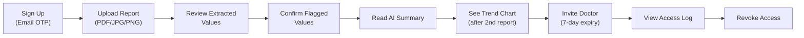
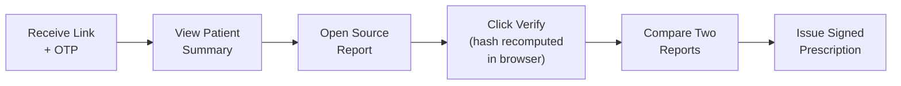
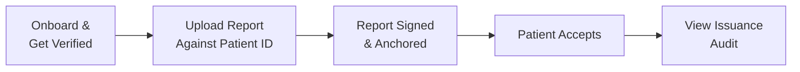
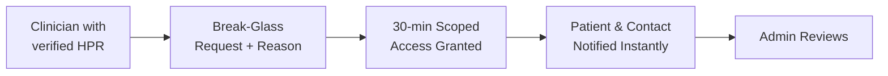

# MediChain AI — Product Requirements Document (PRD)

> **Version:** 1.0 · **Date:** 8 November 2026
> **Status:** Draft — Pre-development
> **Author:** Derived from [MediChain_AI_Blueprint.pdf](file:///D:/Medichain/MediChain_AI_Blueprint.pdf)

---

## 1. Problem Statement

Healthcare information is **fragmented** across hospitals, labs, clinics, and phones. Patients lack a unified history and struggle to understand reports. Clinicians lack historical context. Documents cannot be easily verified for authenticity. Patients cannot see who accessed their data.

Storage and AI summaries are being **commoditized** (Aarogya Setu 2.0, Eka Care). This PRD therefore prioritizes:
1. **Verifiability** — Cryptographic proof that a report is unmodified since registration
2. **Patient-readable access control** — Transparent logs of who saw what and when
3. **Clinician-ready synthesis** — One-page trend summaries for doctors

---

## 2. Product Vision

> *Every person in India can carry a complete, verifiable medical history, understand it, and decide precisely who sees it, with proof when something is shown or changed.*

### Positioning

MediChain AI is the **trust layer and clinician workflow** on top of records — not another place to dump PDFs.

| Question | Answer |
|----------|--------|
| **Who is it for first?** | Chronic-condition patients (diabetes, thyroid, kidney, cardiac) with years of lab reports, and the doctors who see them |
| **Unique promise** | "Every report is provably unaltered, every access is logged for you, and your doctor gets a one-page trend summary" |
| **What we deliberately don't do** | Diagnose, prescribe, replace ABDM, or hold health data on a public chain |
| **How we coexist with ABDM** | Phase 2 adds ABHA login (M1) and consent-based record fetch (M3 HIU) |

---

## 3. Target Personas

| Persona | Profile | Top Needs | Pain Today |
|---------|---------|-----------|------------|
| **Asha** (Patient) | 44, Type-2 diabetes, reports from 3 labs over 6 years, Android, Hindi/English | See HbA1c trend; understand new reports; share selectively; know who looked | Photos of paper reports; can't explain history in 8-min consults |
| **Dr. Rao** (GP/Endocrinologist) | Private clinic, 40 patients/day, basic EMR | One-page summary with deltas; confidence a report is genuine; issue signed Rx | Patients arrive with loose papers; can't check authenticity |
| **City Diagnostics** (Lab) | Mid-size lab, LIS exports PDFs | Deliver verifiable reports; reduce "is this real?" calls; issuance audit trail | Reports forwarded as unverifiable PDFs |
| **Admin** (Platform Ops) | Trust & safety / support lead | Verify institutions; review suspicious access; handle breach workflow | No unified view of access anomalies |

---

## 4. User Journeys

### 4.1 Patient Journey

### 4.2 Doctor Journey

### 4.3 Lab Journey

### 4.4 Emergency Access (Post-MVP)

---

## 5. Feature Prioritization Matrix

> Scores 1-5 (5 = best). Complexity and time are inverted (higher = easier/shorter).

| Feature | User Value | Ease | Dev Speed | Demo Power | Long-term Viability | **Total /25** | Decision |
|---------|-----------|------|-----------|------------|-------------------|--------------|----------|
| **F1** Unified Records (upload, library) | 5 | 4 | 4 | 3 | 4 | **20** | ✅ MVP |
| **F2** AI Document Intelligence | 5 | 3 | 3 | 5 | 3 | **19** | ✅ MVP (core) |
| **F3** Longitudinal Analytics | 5 | 4 | 4 | 5 | 5 | **23** | ✅ MVP |
| **F4** AI Assistant (RAG) | 4 | 3 | 3 | 4 | 3 | **17** | ✅ MVP-lite |
| **F5** Blockchain Verification | 3 | 4 | 4 | 5 | 3 | **19** | ✅ MVP (core) |
| **F6** Access Management | 5 | 3 | 3 | 4 | 5 | **20** | ✅ MVP (off-chain) |
| **F7** Emergency Access | 4 | 1 | 1 | 3 | 4 | **13** | 🔜 Post-MVP |
| **F8** Verifiable Prescriptions | 4 | 2 | 2 | 4 | 5 | **17** | 🔜 Phase 2 |

---

## 6. Functional Requirements

| ID | Requirement | Priority | Phase |
|----|-------------|----------|-------|
| **FR-01** | Users register/sign in with email OTP; role = patient, doctor, lab, or admin | P0 | MVP |
| **FR-02** | Patient uploads PDF/JPG/PNG ≤ 15 MB; file encrypted before storage | P0 | MVP |
| **FR-03** | System extracts text (PDF layer, else OCR/vision) → structured analytes `{name, value, unit, ref_range, flag, page, bbox}` | P0 | MVP |
| **FR-04** | Patient can edit/confirm any extracted value; edited values marked "user-corrected" | P0 | MVP |
| **FR-05** | System generates plain-language summary with abnormal values highlighted and non-diagnostic disclaimer | P0 | MVP |
| **FR-06** | Analyte series normalized and charted over time; ranges configurable per lab/patient | P0 | MVP |
| **FR-07** | Report-to-report comparison with deltas and direction | P0 | MVP |
| **FR-08** | Document fingerprint registered on testnet; transaction reference stored | P0 | MVP |
| **FR-09** | Verification recomputes hash from retrieved file, compares with chain; shows result, network, tx, timestamp | P0 | MVP |
| **FR-10** | Patient grants doctor access to selected records with expiry; revoke is immediate | P0 | MVP |
| **FR-11** | Every read of a patient record writes an audit event visible to the patient | P0 | MVP |
| **FR-12** | AI assistant answers only from requesting user's authorized records and cites sources | P1 | MVP-lite |
| **FR-13** | Lab portal issues signed reports to a patient | P1 | Phase 2 |
| **FR-14** | Doctor issues digitally signed prescription with QR verification | P1 | Phase 2 |
| **FR-15** | Break-glass emergency access with notifications and review | P2 | Phase 3 |
| **FR-16** | ABHA login (M1) and consent-based record fetch (M3) | P1 | Phase 2 |
| **FR-17** | Data export and account deletion (crypto-shred) | P1 | Phase 2 |
| **FR-18** | Consent Manager-compatible consent records and withdrawal | P1 | Phase 2 |

---

## 7. Non-Functional Requirements

| Area | Requirement |
|------|-------------|
| **Security** | TLS 1.2+; AES-256-GCM per-file encryption; no PHI in logs; secrets in env/KMS; OWASP ASVS L2 target |
| **Privacy / Compliance** | DPDP-ready consent notices; 1-year log retention; 72-hour breach reporting runbook |
| **Performance** | Dashboard p95 < 2s; upload-to-summary p50 < 45s (MVP) |
| **Reliability** | MVP: best effort. Beta: 99.5%, daily backups, tested restore |
| **Accessibility** | WCAG 2.2 AA; keyboard operable; no color-only status |
| **Localization** | English first; Hindi next; layout ready for Indic scripts |
| **Auditability** | Append-only audit table; periodic Merkle root anchored on-chain |
| **Maintainability** | Typed end-to-end; migrations; CI runs unit, API, and contract tests |

---

## 8. User Stories & Acceptance Criteria

| Story | Acceptance Criteria |
|-------|-------------------|
| **As a patient** I upload a blood report so I can see my values | 1) PDF ≤ 15 MB accepted. 2) Within 60s analytes appear with units. 3) Each value links to source region. 4) Unreadable file → clear error, no partial save. |
| **As a patient** I correct a wrongly read value | 1) Edit saves immediately. 2) Original extracted value retained in history. 3) Chart updates. |
| **As a patient** I compare two reports | 1) Select two dates. 2) Table shows shared analytes, delta, direction. 3) Different units converted or flagged, never silently mixed. |
| **As a patient** I share with Dr. Rao for 7 days | 1) Choose records. 2) Doctor sees only those. 3) After expiry/revoke, API returns 403 within 2s. 4) Log shows each view. |
| **As a doctor** I verify a report | 1) Verify button recomputes SHA-256 in browser. 2) Match → green "Unmodified since [time]" + tx link. 3) Altered file → red mismatch. |
| **As a patient** I ask "what changed since January?" | 1) Answer cites report IDs and dates. 2) Declines diagnosis or dosing. 3) Never references records outside authorization. |

---

## 9. MVP Definition vs Product Vision

| Hackathon MVP (24-48h) | Beta (Months 1-6) | Full Vision (Months 6-15) |
|------------------------|--------------------|-----------------------|
| Patient & doctor roles; upload; extraction on synthetic reports; summary; trends; compare; hash register/verify; grant/revoke with audit log; simple grounded Q&A | Lab issuance with signatures; real encryption keys via KMS; ABHA M1; DPDP consent records; backups; paid hosting; VAPT; localization | M2/M3; signed prescriptions; emergency access; batching & Merkle anchoring; insurer verification API; mobile app |

---

## 10. Product Objectives & Metrics

| Objective | Metric | Target (Hackathon) | Target (Beta) |
|-----------|--------|-------------------|---------------|
| Fast report understanding | Upload-to-summary latency (p50) | < 45s | < 30s |
| Extraction trustworthiness | Analyte-level accuracy on 50-report gold set | Measured, not claimed | ≥ 95% printed; every value human-confirmable |
| Verification works | Hash mismatch detected on tampered file | 100% in demo | 100% |
| Patient control | Grant/revoke time to effect | < 2s | < 2s |
| Adoption signal | Users with ≥ 3 reports uploaded | n/a | 40% of activated users |

### Success Metrics by Stage

| Stage | Metric | Target |
|-------|--------|--------|
| Hackathon | End-to-end demo with no manual intervention | 3 consecutive rehearsals |
| Hackathon | Judge-visible tamper test (edit one byte → verification fails) | Works live |
| Beta | Activation (first report uploaded within 24h) | ≥ 60% |
| Beta | Extraction field accuracy on gold set | ≥ 95% printed, ≥ 85% photos |
| Beta | Doctors who verify at least one report | ≥ 30% of invited |
| Beta | Median grant-to-first-view time | < 1 day |

---

## 11. Dependencies, Risks & Assumptions

| Item | Type | Detail / Mitigation |
|------|------|-------------------|
| ABDM sandbox access and certification | Dependency | Needs HFR/HPR registration, bridge, security audit; any 2 milestones to exit sandbox |
| Lab cooperation | Dependency | Pilot with one friendly lab before building portal |
| Incorrect extraction harms users | Risk (High) | Human confirm step; never auto-flag diagnosis; accuracy dashboard |
| Incumbents free and state-backed | Risk (High) | Validate wedge; pivot to B2B verification if needed |
| Regulatory non-compliance | Risk (High) | Legal review before real data; DPDP checklist |
| Free-tier instability | Risk (Medium) | Abstract providers; keepalive; demo rehearsal |
| Users accept hash-only as "authenticity" | Risk (Medium) | Label clearly: integrity since registration, not origin, unless signed by issuer |
| Exchange rate: ₹90/USD | Assumption | Re-check |
| Solo developer, 15-20 productive hrs/week | Assumption | Drives roadmap durations |

---

## 12. Out of Scope (Explicitly)

- Medical diagnosis or prescription
- Replacing ABDM
- Storing health data on a public chain
- Real patient data during hackathon
- Mobile native app (until Phase 3)
- Multi-language support beyond English (until Phase 2)

