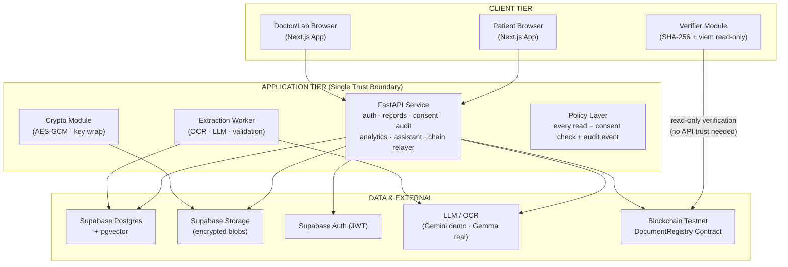
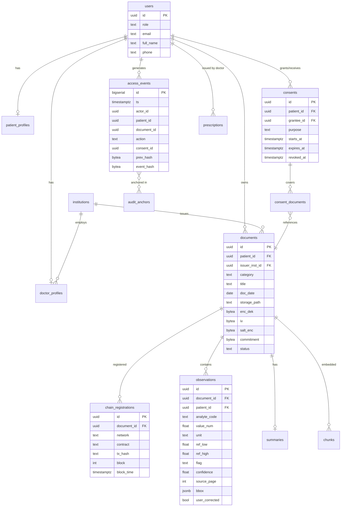
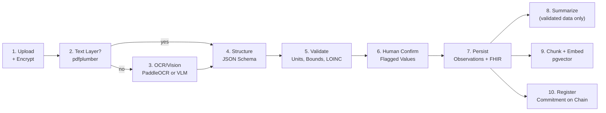
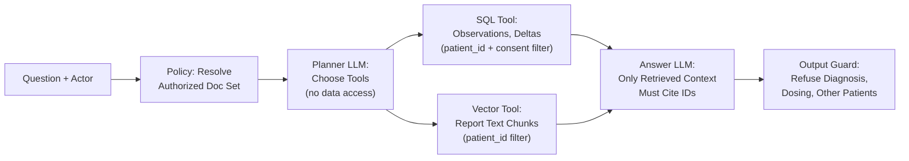

# MediChain AI — Technical Specification Sheet

> **Version:** 1.0 · **Date:** 8 November 2026
> **Source:** [MediChain_AI_Blueprint.pdf](file:///D:/Medichain/MediChain_AI_Blueprint.pdf)

---

## 1. System Architecture Overview



### Core Principles
1. **All data access passes the policy layer** — consent check → audit write → data
2. **Browser never holds master keys** or relayer wallet
3. **Chain only sees salted commitments** — never identity or content
4. **Verification path reads chain directly** — MediChain cannot forge a "verified" badge

---

## 2. Technology Stack (Pinned)

| Layer | Technology | Version/Notes |
|-------|-----------|---------------|
| **Web App** | Next.js (App Router), TypeScript, Tailwind CSS, shadcn/ui, Recharts, TanStack Query | Types generated from OpenAPI |
| **API** | FastAPI, Pydantic v2, SQLAlchemy 2 (async) + Alembic, httpx, cryptography, web3.py | Single authorization layer |
| **Worker** | FastAPI BackgroundTasks (MVP) → Arq/RQ + Redis | OCR and AI jobs |
| **Database** | Supabase Postgres + pgvector, Supabase Storage (encrypted blobs) | RLS on, service role only in API |
| **AI** | pdfplumber/pypdfium2, PaddleOCR, Gemini Flash (demo) / Gemma 4 (real), Medical Data Toolkit | Schema-constrained JSON output |
| **Blockchain** | Solidity ^0.8.x, Hardhat 3, OpenZeppelin, viem | Contract ~40 lines |
| **Chain** | Polygon Amoy (chain 80002) OR Base Sepolia | Pick ONE |
| **Ops** | GitHub Actions, Sentry free, UptimeRobot | Keepalive cron for Supabase |

---

## 3. Frontend Architecture

### 3.1 Route Structure
```
app/
├── (auth)/          # Login, registration
├── (patient)/       # Patient dashboard, records, analysis, assistant, access
├── (doctor)/        # Doctor dashboard, patient list, summaries, compare
├── (lab)/           # Lab portal, issuance (Phase 2)
├── (admin)/         # Admin panel, institution verification
components/
├── ui/              # shadcn/ui re-themed components
├── seal/            # SealBadge (verified/unregistered/mismatch/issuer-signed)
├── charts/          # TrendChart, RangeBar, CompareView
lib/
├── api/             # Typed client from OpenAPI
├── verify/          # Web Crypto SHA-256 + viem public client
├── format/          # Unit conversion, date formatting
hooks/
styles/
└── tokens.css       # Design tokens
```

### 3.2 Key Design Decisions
- **Server Components** for lists and dashboards; **Client Components** for upload, charts, verifier
- **TanStack Query** against typed client generated from FastAPI's OpenAPI
- **No direct database access** from Next.js
- **Auth:** Supabase Auth session → Bearer token → FastAPI validates
- **Verifier:** Web Crypto SHA-256 + viem public client for chain reads — no secrets

### 3.3 Visual Identity Tokens

| Token | HEX | Use |
|-------|-----|-----|
| Ink | `#10222E` | Primary text, navigation |
| Paper | `#F6F4EE` | App background |
| Surface | `#FFFFFF` | Cards, tables |
| Verdigris | `#1F7A6D` | Primary actions, healthy/in-range, verified |
| Verdigris Deep | `#14584F` | Headings, pressed states |
| Sage | `#DDE8E2` | Verified surface, in-range bands |
| Seal Blue | `#2B5FA8` | AI-generated content |
| Amber | `#B7791F` | Caution, not-yet-registered, low confidence |
| Vermilion | `#B4421C` | Out-of-range, mismatch, destructive |

**Typography:** Headings — Source Serif 4 / Fraunces; Body — IBM Plex Sans; Numbers/hashes — IBM Plex Mono (tabular figures)

---

## 4. Backend Architecture

### 4.1 Directory Structure
```
backend/
  app/
    main.py                # App factory, CORS, middleware, error handlers
    core/
      config.py            # Environment-based config
      security.py          # JWT validation, role extraction
      crypto.py            # AES-256-GCM envelope encryption
      policy.py            # can_read(actor, document) — single authorization point
      logging.py           # Structured logging, no PHI
    db/
      session.py           # Async SQLAlchemy session
      models/              # SQLAlchemy models (single source of truth)
      alembic/             # Migration scripts
    modules/
      auth/                # router.py, service.py, repo.py, schemas.py
      users/
      records/
      extraction/
      analytics/
      consent/
      audit/
      chain/
      assistant/
      prescriptions/       # Phase 2
      admin/
    workers/
      extract.py           # OCR + LLM extraction
      summarise.py         # AI summary generation
      embed.py             # Chunk + embed for pgvector
      anchor.py            # Chain registration
  tests/
    unit/                  # Policy, crypto, normalisation
    api/                   # Consent matrix: every role × every endpoint
    contract/              # Hardhat tests
    eval/                  # Extraction gold set regression
```

### 4.2 Layering
```
Router (HTTP, validation) → Service (rules, transactions) → Repository (queries)
```

Authorization expressed **once** in `policy.py` (`can_read(actor, document)`) and used by every service.

### 4.3 API Conventions
- Base path: `/api/v1`
- Auth: Bearer JWT
- Errors: `{"error": {"code": "...", "message": "...", "request_id": "..."}}`
- Cursor pagination
- `Idempotency-Key` on uploads and chain writes
- Rate limit: 60 req/min per user (10 for auth and AI endpoints)

---

## 5. Encryption & File Storage

| Item | Design |
|------|--------|
| **At rest (file)** | Per-file random 256-bit DEK → AES-256-GCM → ciphertext in private bucket → DEK wrapped with KEK → stored in `documents.enc_dek` |
| **KEK** | MVP: environment secret (rotatable). Production: managed KMS (AWS KMS Mumbai) with per-patient KEKs → crypto-shred by deleting KEK |
| **In transit** | TLS everywhere; HSTS; signed short-lived URLs NOT used for plaintext; API streams decrypted bytes after policy check |
| **Database** | Provider encryption at rest + application encryption for salt and free-text PHI fields |
| **Backups** | Encrypted; restore drill quarterly; retention meets 1-year log requirement |
| **Logs** | No PHI, no file names with identities; user IDs only |

---

## 6. Database Schema (Core Entities)



### Key Design Notes
- **Observations** are the analytic spine — index `(patient_id, analyte_code, observed_at)`
- **Access events** are append-only and hash-chained: `event_hash = sha256(prev_hash ‖ canonical(event))`
- **RLS** on every patient-scoped table as defense in depth
- **Migrations** via Alembic only; schema defined once in SQLAlchemy models
- **FHIR** `jsonb` column on observations/documents for ABDM exports (Phase 2)

---

## 7. Core API Endpoints

| Method | Path | Role | Purpose |
|--------|------|------|---------|
| `POST` | `/auth/session/exchange` | any | Validate Supabase JWT, return profile + role |
| `GET/PATCH` | `/me` | any | Profile |
| `POST` | `/documents` | patient, lab | Create document + upload (multipart); returns `id, status=processing` |
| `GET` | `/documents` | patient | List with filters (category, date, verified) |
| `GET` | `/documents/{id}` | patient, consented doctor | Metadata; writes audit event |
| `GET` | `/documents/{id}/file` | patient, consented doctor | Decrypted stream; policy + audit; returns salt in `X-Doc-Salt` header |
| `GET` | `/documents/{id}/extraction` | patient, consented doctor | Observations, confidence, summary |
| `PATCH` | `/observations/{id}` | patient | Correct a value; stores original |
| `POST` | `/documents/{id}/confirm` | patient | Confirm extraction; triggers chain registration |
| `GET` | `/documents/{id}/verification` | patient, doctor | Stored commitment, tx, block time |
| `GET` | `/analytics/series` | patient, consented doctor | `?analyte=&from=&to=` → time series with ranges |
| `GET` | `/analytics/compare` | patient, consented doctor | `?a=&b=` → deltas |
| `POST` | `/assistant/query` | patient, consented doctor | `{question, context_ids[]}` → answer + citations |
| `POST` | `/consents` | patient | Grant: grantee, document_ids[], expires_at, purpose |
| `DELETE` | `/consents/{id}` | patient | Revoke (immediate) |
| `GET` | `/consents` | patient, doctor | List active/expired |
| `GET` | `/access-log` | patient | Filterable timeline of access events |
| `GET` | `/doctor/patients` | doctor | Patients with active consent |
| `GET` | `/doctor/patients/{id}/summary` | doctor | One-page trend summary (JSON; PDF export) |
| `POST` | `/lab/documents` | lab | Issue signed report (Phase 2) |
| `POST` | `/prescriptions` | doctor | Create, sign, anchor (Phase 2) |
| `GET` | `/prescriptions/{id}/verify` | public + token | QR verification (Phase 2) |
| `POST` | `/emergency/requests` | verified clinician | Break-glass (Phase 3) |
| `GET` | `/admin/events` | admin | Anomalies, institution approval |

### Role-Based Access

| Role | Can | Cannot |
|------|-----|--------|
| **patient** | Everything on own data; grant/revoke; export | See other patients |
| **doctor** | Read consented documents until expiry; issue Rx; request emergency access | Read outside consent; delete patient data |
| **lab** | Issue documents to patients; view own issuance audit | Read patient records after issuing (unless granted) |
| **admin** | Verify institutions; view anomaly queue; no PHI access by default | Open document files (break-glass dual approval only) |

### Error Handling
- `400` validation, `401` auth, `403` policy (never reveal existence), `404`, `409` conflict
- `422` extraction failure, `429` rate limit, `502` provider/chain failure
- Chain writes retried with backoff; "pending" state never blocks user

---

## 8. AI/ML Pipeline

### 8.1 Document Intelligence Pipeline (10 Stages)



> [!IMPORTANT]
> **Stage 6 (Human Confirm)** is what makes the system safe. Low-confidence or out-of-range values block "Save" until confirmed.

### 8.2 Extraction JSON Schema

```json
{
  "report": {
    "lab_name": "str",
    "report_date": "YYYY-MM-DD",
    "patient_name_present": "bool"
  },
  "observations": [{
    "name": "str",
    "value": "number|null",
    "value_text": "str|null",
    "unit": "str|null",
    "ref_low": "number|null",
    "ref_high": "number|null",
    "lab_flag": "H|L|N|null",
    "page": "int",
    "bbox": "[x0, y0, x1, y1]"
  }]
}
```

### 8.3 OCR Strategy

| Engine | Accuracy | Use Case |
|--------|----------|----------|
| **PDF text layer** (pdfplumber) | Exact | Try first; most lab PDFs are digital |
| **PaddleOCR** (PP-OCRv5/v6) | CER 0.111 on Indian reports | Self-hosted pipeline default |
| **Compact VLM** (Gemini Flash) | Best on noisy reports | Demo + phone photos |
| **Tesseract 5** | CER 0.189 | Fallback for clean scans only |

### 8.4 RAG Architecture



### 8.5 Model Strategy

| Stage | Hackathon (Synthetic Only) | Real Data |
|-------|--------------------------|-----------|
| Extraction | Gemini Flash-class (free tier) | Gemma 4 (self-hosted) or paid zero-retention API |
| Summaries/Chat | Gemini Flash-class | Same family, privately hosted |
| Embeddings | Free-tier embedding model | Local sentence-transformers |
| Evaluation | 10 synthetic reports | 50-report gold set with field-level labels |

---

## 9. Blockchain Implementation

### 9.1 What Goes Where

| Data | On-Chain | Off-Chain | Why |
|------|----------|-----------|-----|
| Document file | ❌ | Encrypted in storage | Size, privacy, DPDP erasure |
| Commitment `keccak256(sha256 ‖ salt)` | ✅ | Also in DB | Tamper evidence |
| Registrar address + timestamp | ✅ | Mirror in DB | Independent timestamp |
| Issuer identity/signature | Address only | Institution details in DB | Verify origin, protect patients |
| Consents & revocations | ❌ | DB + audit log | Server enforces access |
| Audit-log Merkle root | ✅ (periodic) | Full log in DB | Detect silent edits to history |
| Patient identity | ❌ | Encrypted DB | Privacy |

### 9.2 Smart Contract (DocumentRegistry)

```solidity
// SPDX-License-Identifier: MIT
pragma solidity ^0.8.24;
import "@openzeppelin/contracts/access/Ownable.sol";

contract DocumentRegistry is Ownable {
    struct Entry { address registrar; uint64 timestamp; }

    mapping(bytes32 => Entry) public entries;      // commitment => entry
    mapping(address => bool) public issuers;       // verified labs/doctors

    event Registered(bytes32 indexed commitment, address indexed registrar, uint64 ts);
    event RootAnchored(bytes32 indexed root, uint64 ts);

    constructor() Ownable(msg.sender) {}

    function setIssuer(address a, bool ok) external onlyOwner {
        issuers[a] = ok;
    }

    function register(bytes32 c) external {
        require(entries[c].timestamp == 0, "exists");
        entries[c] = Entry(msg.sender, uint64(block.timestamp));
        emit Registered(c, msg.sender, uint64(block.timestamp));
    }

    function anchorRoot(bytes32 root) external onlyOwner {
        emit RootAnchored(root, uint64(block.timestamp));
    }

    function verify(bytes32 c) external view returns (bool ok, address who, uint64 ts) {
        Entry memory e = entries[c];
        return (e.timestamp != 0, e.registrar, e.timestamp);
    }
}
```

> [!WARNING]
> This is a design sketch, not audited code. Add: pause switch, tests for duplicate/zero commitments, and `registerSigned(commitment, issuedAt, signature)` EIP-712 variant for lab/doctor signing.

### 9.3 Registration & Verification Flow

```mermaid
sequenceDiagram
    participant U as Patient/Lab Browser
    participant API as FastAPI
    participant S as Storage
    participant C as Contract

    Note over U,C: Registration Flow
    U->>API: Upload file + sha256 (client-computed)
    API->>API: Recompute sha256; salt = random 32 bytes
    API->>S: AES-GCM encrypt, store blob
    API->>C: register(commitment) via relayer
    C->>API: tx hash, block time (event)
    API->>U: status: verified + seal

    Note over U,C: Verification Flow (later)
    U->>API: GET file + salt (consent + audit)
    U->>U: commitment = keccak256(sha256(file) ‖ salt)
    U->>C: viem read: entries(commitment)
    C->>U: registrar, timestamp
    U->>U: Compare → Match/Mismatch
```

### 9.4 Gas Optimization
- Register only after patient confirms — **once per document**
- No transaction for grants, revokes, reads, or chat
- **Production:** Batch commitments into Merkle root per hour/day; per-document proofs stored off-chain
- Relayer pays gas; hot key in secrets manager with daily spend cap
- **Estimated gas:** 50,000-80,000 per registration transaction

---

## 10. Deployment Infrastructure

### Hackathon (₹0)

| Component | Platform | Limitations |
|-----------|----------|-------------|
| Frontend | Vercel Hobby | Non-commercial only; 100 GB transfer |
| Backend | Render Free | 512 MB RAM; sleeps after 15 min |
| Database + Auth + Storage | Supabase Free | 500 MB DB; 1 GB files; pauses after ~1 week |
| Blockchain | Polygon Amoy / Base Sepolia faucets | Testnet; no real value |
| AI | Gemini Free Tier | Synthetic data ONLY |

### Production (~50K users)

| Component | Spec | Monthly Cost (₹) |
|-----------|------|-----------------|
| Managed Postgres (HA + replica) | Indian region, PITR backups | 40,000 - 80,000 |
| Application compute | 2-4 API + worker instances, autoscaling | 30,000 - 60,000 |
| Object storage + CDN | 1-5 TB encrypted | 5,000 - 15,000 |
| KMS, secrets, WAF, DDoS | Per-patient KEKs, rotation | 15,000 - 30,000 |
| Logging + monitoring | 1-year retention (DPDP) | 20,000 - 40,000 |
| AI inference | Self-hosted GPU or private API | 30,000 - 1,00,000 |
| Blockchain | Batched mainnet L2 + RPC plan | 5,000 - 20,000 |

---

## 11. Testing Strategy

| Test Type | Scope | Tools |
|-----------|-------|-------|
| **Unit** | Policy, crypto, normalisation | pytest |
| **API** | Consent matrix: every role × every endpoint | pytest + httpx |
| **Contract** | Hardhat tests (register, verify, duplicate, zero commitment) | Hardhat 3 |
| **Extraction Regression** | 50-report gold set, field-level accuracy | Custom eval harness |
| **E2E** | Demo path end-to-end | Playwright |
| **Adversarial** | 30 prompt-injection attempts | Manual + automated |

