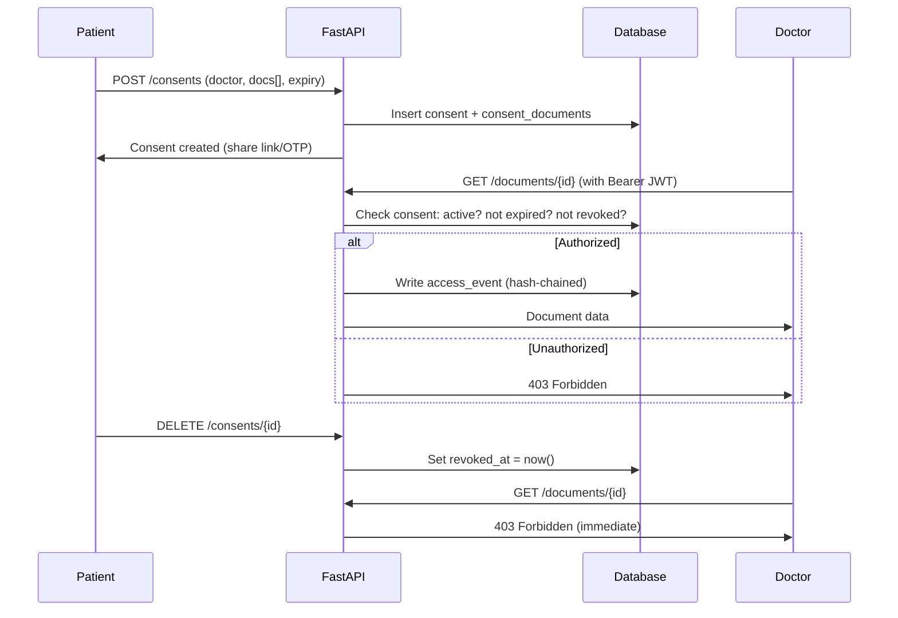
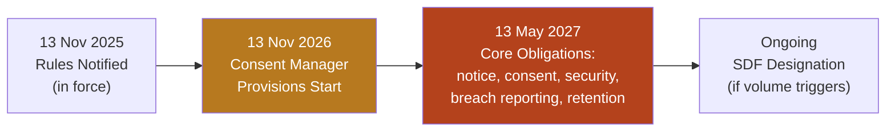

# MediChain AI — Step-by-Step Implementation Plans

> **Version:** 1.0 · **Date:** 8 November 2026
> **Source:** [MediChain_AI_Blueprint.pdf](file:///D:/Medichain/MediChain_AI_Blueprint.pdf)

---

## Table of Contents

1. [Master Roadmap Overview](#1-master-roadmap-overview)
2. [Pre-Coding Checklist](#2-pre-coding-checklist)
3. [Plan A: Hackathon MVP (24-48 hours)](#3-plan-a-hackathon-mvp-24-48-hours)
4. [Plan B: Full Product Roadmap (9-15 months)](#4-plan-b-full-product-roadmap-9-15-months)
5. [Subsystem Plan 1: Foundation & Infrastructure](#5-subsystem-plan-1-foundation--infrastructure)
6. [Subsystem Plan 2: Records & AI Intelligence](#6-subsystem-plan-2-records--ai-intelligence)
7. [Subsystem Plan 3: Blockchain Integration](#7-subsystem-plan-3-blockchain-integration)
8. [Subsystem Plan 4: Access Management & Doctor Workflows](#8-subsystem-plan-4-access-management--doctor-workflows)
9. [Subsystem Plan 5: Security & Compliance](#9-subsystem-plan-5-security--compliance)
10. [Your First 7 Days](#10-your-first-7-days)

---

## 1. Master Roadmap Overview

```mermaid
flowchart LR
    subgraph H["HACKATHON\n24-48h"]
        H1["Repo + Env + CI"] --> H2["Auth + Schema"]
        H2 --> H3["Upload + Encrypt"]
        H3 --> H4["Extraction + Confirm"]
        H4 --> H5["Trends + Compare"]
        H5 --> H6["Contract + Verify"]
        H6 --> H7["Consent + Audit"]
        H7 --> H8["Doctor View"]
        H8 --> H9["Assistant-lite"]
        H9 --> H10["Polish + Rehearse"]
    end

    subgraph P2["BETA\nMonths 1-6"]
        P2A["Foundation Rewrite"] --> P2B["Core App"]
        P2B --> P2C["AI Hardening"]
        P2C --> P2D["Blockchain Prod"]
        P2D --> P2E["Lab/Doctor Workflows"]
    end

    subgraph P3["FULL VISION\nMonths 6-15"]
        P3A["ABDM M2/M3"] --> P3B["Signed Rx"]
        P3B --> P3C["Emergency Access"]
        P3C --> P3D["Mobile App"]
        P3D --> P3E["Enterprise"]
    end

    H10 --> P2A
    P2E --> P3A
```



---

## 2. Pre-Coding Checklist

> [!IMPORTANT]
> Complete ALL of these before writing a single line of code.

| # | Task | Details | Time Est. |
|---|------|---------|-----------|
| 1 | **Confirm free-tier limits** | Visit official pricing pages for Supabase, Render, Vercel, Gemini API, Polygon Amoy faucets | 20 min |
| 2 | **Create accounts** | Supabase project, Render account, Vercel account, Google AI Studio, Alchemy account | 30 min |
| 3 | **Fund relayer wallet** | Create MetaMask/burner wallet, get testnet POL from Alchemy faucet on Polygon Amoy | 15 min |
| 4 | **Initialize repository** | `git init`, monorepo structure, `.gitignore`, `.env.example`, secrets policy doc | 15 min |
| 5 | **Write AGENTS.md** | Paste Sections 7, 10, 11, 12, 13 from blueprint for AI coding agents to reference | 30 min |
| 6 | **Generate synthetic reports** | 10 varied lab report PDFs (different layouts, fonts, scan quality, Hindi/English headers) with ground-truth JSON | 2-3 hrs |
| 7 | **Set up CI** | GitHub Actions: lint, type-check, test on push | 30 min |
| 8 | **Supabase keepalive** | Set up a cron job or scheduled function to ping Supabase (prevents free-tier pausing) | 15 min |

---

## 3. Plan A: Hackathon MVP (24-48 hours)

### 3.1 The 10-Step Demo

| Step | Demo Action | Real or Simulated | Risk |
|------|------------|-------------------|------|
| 1 | Patient creates account | Real (email OTP via Supabase) | Low |
| 2 | Upload report | Real (encrypted storage) | Low |
| 3 | AI extracts parameters | Real on synthetic PDFs (text layer + vision LLM) | **Medium** |
| 4 | AI summary | Real, non-diagnostic template | Low |
| 5 | Timeline entry | Real | Low |
| 6-7 | Second report + comparison | Real (SQL deltas) | Low |
| 8 | Hash registered on testnet | Real testnet tx; explorer link live | **Medium** |
| 9 | Doctor receives access | Real grant with expiry; doctor logs in with 2nd account | Medium |
| 10 | Doctor verifies integrity | Real browser hash + chain read; tamper test | Medium |

### 3.2 Scope Decisions

| ✅ Essential (Build Real) | ⚡ Simulate (Label on Stage) | ❌ Postpone |
|--------------------------|------------------------------|------------|
| Auth with 2 roles | Lab issuance with issuer signature (pre-seeded) | ABDM integration |
| Upload + AES-GCM encryption | Signed prescription (mock screen) | OCR engine hosting |
| Extraction with confirm | Emergency access (slide only) | Merkle batching |
| Trends + Compare | ABHA login (screenshot) | Mobile app |
| Hash register/verify | | Localisation |
| Consent grant/revoke + audit log | | Real patient data |
| Grounded Q&A (3 canned types) | | |

### 3.3 Development Schedule (36 Hours)

```
Hour  0-2   ██ Repo, env, CI, tokens, synthetic data
Hour  2-6   ████ Auth + DB schema + roles (Supabase Auth + SQLAlchemy + Alembic)
Hour  6-10  ████ Upload + AES-GCM encryption + storage
Hour  10-16 ██████ Extraction + validation + confirm UI (HARDEST SLICE)
Hour  16-20 ████ Trends, compare, summary generation
Hour  20-24 ████ Contract deployment + register + verify UI
Hour  24-28 ████ Consent grant/revoke + audit log
Hour  28-30 ██ Doctor view + one-pager summary
Hour  30-32 ██ Assistant-lite (grounded Q&A)
Hour  32-34 ██ Polish, demo data, README, demo badge
Hour  34-36 ██ Rehearse ×3, backup video recording
```

### 3.4 Slice-by-Slice Implementation

#### Slice 1: Auth + Schema (Hours 2-6)
```
Steps:
1. Define SQLAlchemy models for users, patient_profiles, doctor_profiles
2. Run Alembic migration to create tables in Supabase
3. Set up Supabase Auth (email OTP)
4. Create FastAPI endpoint: POST /auth/session/exchange
   - Validate Supabase JWT
   - Create/update user record
   - Return profile + role
5. Set up FastAPI middleware for JWT verification
6. Write tests: auth flow, role mapping
```

#### Slice 2: Upload + Encryption (Hours 6-10)
```
Steps:
1. Implement crypto.py:
   - generate_dek() → random 256-bit key
   - encrypt_file(dek, plaintext) → (ciphertext, iv)
   - decrypt_file(dek, ciphertext, iv) → plaintext
   - wrap_dek(kek, dek) → encrypted_dek
   - unwrap_dek(kek, encrypted_dek) → dek
2. Create documents SQLAlchemy model
3. POST /documents endpoint:
   - Accept multipart upload (PDF/JPG/PNG ≤ 15 MB)
   - Compute SHA-256 client-side AND server-side
   - Generate DEK, encrypt file
   - Upload ciphertext to Supabase Storage (private bucket)
   - Store metadata + enc_dek + iv + salt in DB
   - Return document_id, status=processing
4. GET /documents endpoint with filters
5. GET /documents/{id}/file with decryption + policy check
6. Build upload UI with staged progress rail
7. Write tests: encryption roundtrip, upload, retrieval
```

#### Slice 3: Extraction + Validation (Hours 10-16)
```
Steps:
1. Implement extraction worker:
   a. Try pdfplumber text extraction first
   b. If text too short → call Gemini Flash vision API
   c. Parse with JSON schema constraint
   d. Validate: unit whitelist, plausibility bounds, LOINC mapping
   e. Assign confidence scores
2. Create observations SQLAlchemy model
3. POST /documents/{id}/confirm endpoint
4. PATCH /observations/{id} for corrections
5. Build extraction review UI:
   - Split view: source document (left) + parameters table (right)
   - RangeBar component for each value
   - Confidence chips
   - Flag low-confidence values requiring confirmation
6. Generate summary from validated observations
7. Write tests: extraction on synthetic reports, validation rules
```

#### Slice 4: Trends + Compare (Hours 16-20)
```
Steps:
1. GET /analytics/series endpoint
   - Query observations by patient_id, analyte_code, date range
   - Return time series with reference ranges
2. GET /analytics/compare endpoint
   - Accept two document IDs
   - Return shared analytes with delta and direction
3. Build TrendChart component (Recharts)
   - Selectable analyte dropdown
   - Reference range bands (Sage color)
   - Data points with tooltips
4. Build CompareDrawer component
   - Side-by-side table
   - Delta with direction arrows
   - Unit mismatch warning
5. AI Insight panel on dashboard
6. Write tests: series calculation, comparison logic
```

#### Slice 5: Smart Contract + Verify (Hours 20-24)
```
Steps:
1. Write DocumentRegistry.sol (~40 lines)
2. Write Hardhat tests:
   - Register a commitment ✓
   - Duplicate commitment reverts ✓
   - Verify returns correct data ✓
   - Zero commitment behavior ✓
3. Deploy to Polygon Amoy testnet
4. Record contract address + ABI
5. Implement chain relayer in FastAPI:
   - On document confirm → compute commitment = keccak256(sha256 ‖ salt)
   - Send register(commitment) transaction via relayer wallet
   - Store tx_hash, block, block_time in chain_registrations
   - Handle retry with backoff, "pending" state
6. Build verification UI:
   - GET /documents/{id}/file downloads file + salt
   - Browser: Web Crypto SHA-256 → keccak256(sha256 ‖ salt)
   - viem public client reads contract directly
   - ResultBanner: verified (green) / not registered (amber) / mismatch (red)
   - KeyValueList: fingerprint, network, contract, tx link, block time
   - ExplainerPanel: what this proves and doesn't prove
7. Tamper test: upload modified file → show red mismatch
```

#### Slice 6: Consent + Audit (Hours 24-28)
```
Steps:
1. Implement policy.py:
   - can_read(actor, document) → bool
   - Checks: ownership, active consent, expiry, revocation
2. Create consents + consent_documents + access_events models
3. POST /consents endpoint (patient grants doctor access)
4. DELETE /consents/{id} (immediate revoke)
5. Audit event logging: every read → access_events
6. Hash-chain audit events: event_hash = sha256(prev_hash ‖ canonical(event))
7. GET /access-log endpoint (patient timeline)
8. Build Access Management UI:
   - PersonCard with scope, expiry countdown, last view
   - GrantDialog: pick doctor, tick records, choose expiry
   - ActivityTimeline: filterable, plain-language reasons
   - RevokeSheet with confirmation
9. Write consent matrix tests: every role × every endpoint
```

#### Slice 7: Doctor View (Hours 28-30)
```
Steps:
1. GET /doctor/patients endpoint (patients with active consent)
2. GET /doctor/patients/{id}/summary (one-page trend summary)
3. Build doctor dashboard:
   - Patient list with consent expiry
   - Summary tab: trend sheet with source-linked values
   - Reports tab: list of accessible reports
   - Compare tab: select two reports
   - AccessBanner: shows access basis + expiry
4. Verify button on each report
```

#### Slice 8: Assistant-Lite (Hours 30-32)
```
Steps:
1. Implement RAG pipeline:
   - Chunk report text (300-500 tokens) with page metadata
   - Embed into pgvector
   - Query: resolve authorized doc set → SQL tool + vector tool
2. POST /assistant/query endpoint
3. Output guardrails: refuse diagnosis, dosing, other patients
4. Build chat UI:
   - Context selector (all records / chosen reports)
   - Chat thread with source chips
   - Suggested questions ("What changed since January?")
   - GuardrailBanner
5. Test 3 canned question types
```

### 3.5 Demo Script (5 Minutes)

| Time | Action |
|------|--------|
| 0:00 | Problem in one sentence + "Synthetic data, testnet" badge |
| 0:30 | Patient signs up, uploads report 1. Staged progress → extracted values → confirm → summary |
| 1:30 | Upload report 2: trend chart updates; comparison with deltas |
| 2:15 | Click Register: show tx link on explorer |
| 2:45 | Grant Dr. Rao 24h access. Switch to doctor: one-page summary |
| 3:30 | Verify: green. Upload tampered copy: red mismatch. State what this proves/doesn't |
| 4:15 | Back as patient: access log shows views; revoke → doctor gets 403 |
| 4:45 | Roadmap slide: ABDM, signed issuance, DPDP readiness; honest simulated parts list |

### 3.6 Pre-Flight Checklist

- [ ] Wake Render service 5 minutes before demo
- [ ] Confirm relayer wallet balance (≥ 0.5 POL)
- [ ] Confirm RPC endpoint is responding
- [ ] Verify Supabase project is NOT paused
- [ ] Have tampered file ready
- [ ] Keep screen recording of successful run as backup

---

## 4. Plan B: Full Product Roadmap (9-15 months)

> **Assumption:** Solo developer, 15-20 productive hours/week, AI-assisted coding, legal/audit outsourced.

| Phase | Scope | Duration | Depends On | Likely Blockers |
|-------|-------|----------|------------|----------------|
| **1. Foundation** | Repo, CI, environments, design tokens, auth, schema, policy layer, audit, encryption, observability | 3-4 wk | Hackathon code as spike | Rewrite vs refactor; KMS setup |
| **2. Core Application** | Records library, categories, search, sharing, doctor view, notifications, export/delete | 5-7 wk | Phase 1 | Scope creep; UX iteration |
| **3. AI Intelligence** | Gold set, extraction hardening, Medical Data Toolkit/FHIR, trends with unit conversion, RAG, eval harness, private model hosting | 6-8 wk | Phase 2 | Model hosting cost; accuracy on phone photos |
| **4. Blockchain Integration** | Contract audit-lite, relayer, batching with Merkle proofs, audit-root anchoring, mainnet decision | 3-4 wk | Phase 2 | Key management; fee volatility |
| **5. Doctor & Lab Workflows** | Institution onboarding, issuer signatures, lab portal, prescriptions with QR, ABHA M1 then M3 | 10-14 wk | Phase 4 + ABDM sandbox | Lab pilots; NHA audit timelines |
| **6. Security & Compliance** | DPDP notices, consent, breach runbook, retention, VAPT, legal review, DPO, privacy page | 6-8 wk (parallel from Phase 2) | Legal counsel | Interpretation of Rules; children's data |
| **7. Testing** | Consent matrix, E2E, load test, restore drill, red-team prompts | Continuous + 3 wk hardening | All | Flaky AI tests |
| **8. Production Deployment** | Indian-region hosting, backups, monitoring, status page, support, closed beta (50-100 users) | 3-4 wk | Phases 6, 7 | Vendor approvals; data residency |
| **9. Future Scaling** | Emergency access, insurer API, mobile apps, vernacular languages, ABDM M2, enterprise tier | Ongoing | Phase 8 | Funding and partnerships |

> **Total:** Roughly **9-14 months** to a compliant, audited closed beta.

---

## 5. Subsystem Plan 1: Foundation & Infrastructure

### Goal
Establish the project skeleton, dev environment, CI/CD, auth, database schema, policy layer, encryption module, and observability — the base every other subsystem builds on.

### Steps

| # | Task | Details | Deliverable | Tests |
|---|------|---------|-------------|-------|
| 1.1 | **Monorepo Setup** | Create directory structure: `frontend/`, `backend/`, `contracts/`, `docs/`, `.github/` | Working repo with README | - |
| 1.2 | **Environment Config** | `.env.example` with all required vars (Supabase URL/keys, relayer PK, Gemini API key, KEK) | env template | - |
| 1.3 | **CI Pipeline** | GitHub Actions: lint (ruff + eslint), type-check (mypy + tsc), test (pytest + vitest), contract test (hardhat) | Green CI on push | - |
| 1.4 | **Frontend Scaffold** | Next.js App Router, Tailwind, shadcn/ui, design tokens from Section 9 | Running dev server | - |
| 1.5 | **Backend Scaffold** | FastAPI app factory, CORS, error handlers, structured logging | `uvicorn` starts clean | Health check endpoint |
| 1.6 | **Database Models** | SQLAlchemy 2.x models for ALL entities (users, documents, observations, consents, access_events, etc.) | Alembic baseline migration | Model import tests |
| 1.7 | **Supabase Auth Integration** | JWT verification middleware in FastAPI; role extraction | Auth endpoint works | Auth flow tests |
| 1.8 | **Policy Layer** | `policy.py`: `can_read(actor, document)`, `can_write(actor, document)`, consent resolution | Central authorization | Unit tests for every role × action |
| 1.9 | **Crypto Module** | AES-256-GCM: DEK generation, encryption, decryption, KEK wrapping | `crypto.py` | Roundtrip tests, empty/large file tests |
| 1.10 | **Audit Events** | Append-only table with hash chain; `log_event(actor, patient, document, action)` | Audit logging works | Hash chain integrity test |
| 1.11 | **Observability** | Sentry error tracking, structured request logging, health endpoint | Errors appear in Sentry | - |
| 1.12 | **Keepalive** | Cron ping to Supabase to prevent free-tier pausing | Scheduled job | - |

### Dependencies
- Supabase project must be created first
- `.env` populated with real credentials

### Estimated Time
- Hackathon: 6 hours (slices 1-2)
- Full build: 3-4 weeks

---

## 6. Subsystem Plan 2: Records & AI Intelligence

### Goal
Build the document upload pipeline, AI extraction with human confirmation, longitudinal analytics (trends, comparisons), AI summaries, and the RAG-based assistant.

### Steps

| # | Task | Details | Deliverable | Tests |
|---|------|---------|-------------|-------|
| 2.1 | **Synthetic Report Generation** | Create 10 varied lab report PDFs with ground-truth JSON files | Test data set | - |
| 2.2 | **Upload Endpoint** | `POST /documents` — multipart upload, size/type validation, SHA-256 computation | Working upload | Upload tests |
| 2.3 | **File Encryption** | Encrypt with DEK before storage; store ciphertext in Supabase Storage private bucket | Encrypted blobs | Decrypt roundtrip |
| 2.4 | **Text Layer Extraction** | `pdfplumber`/`pypdfium2` — extract text from digital PDFs; skip OCR if text is sufficient | Text extraction | Test on digital PDF |
| 2.5 | **OCR/Vision Fallback** | PaddleOCR (self-hosted) or Gemini Flash vision (demo) — for scanned/photo reports | OCR pipeline | Test on scanned PDF |
| 2.6 | **Schema-Constrained Structuring** | LLM call with JSON schema; temperature 0; one retry on failure | Structured output | Schema validation |
| 2.7 | **Validation Engine** | Unit whitelist per analyte; plausibility bounds (e.g. HbA1c 2-20%); numeric parse; duplicate detection; LOINC mapping | Validated observations | Validation rule tests |
| 2.8 | **Confidence Scoring** | Per value: OCR confidence × model self-check × validation result; < 0.85 → needs confirm | Confidence scores | Threshold tests |
| 2.9 | **Confirm UI** | Split view: source doc with highlight boxes (left) + parameters table with RangeBar (right) | Confirm page | - |
| 2.10 | **Value Correction** | `PATCH /observations/{id}` — stores original, marks user-corrected, updates chart | Correction flow | Correction preserves original |
| 2.11 | **Summary Generation** | Generate from validated observations only; fixed template of allowed statements; disclaimer | AI summary | Non-diagnostic check |
| 2.12 | **Analytics: Time Series** | `GET /analytics/series` — observations by analyte, date range, with reference ranges | Trend data | Series correctness |
| 2.13 | **Analytics: Compare** | `GET /analytics/compare` — two documents, shared analytes, deltas, direction | Comparison data | Delta calculation |
| 2.14 | **Trend Chart UI** | Recharts with selectable analyte, reference range bands, data point tooltips | Chart component | - |
| 2.15 | **Compare Drawer UI** | Side-by-side table, delta with arrows, unit mismatch warning | Compare UI | - |
| 2.16 | **Chunking + Embedding** | Chunk report text (300-500 tokens) with page metadata; embed into pgvector | Vector store | Retrieval test |
| 2.17 | **RAG: SQL Tool** | Query observations by patient_id + consent filter | Structured retrieval | Authorization test |
| 2.18 | **RAG: Vector Tool** | Query pgvector by patient_id + consent filter | Semantic retrieval | Authorization test |
| 2.19 | **RAG: Answer Generation** | Planner → tools → answer LLM with citations | Grounded answers | Citation check |
| 2.20 | **Output Guardrails** | Refuse diagnosis, dosing, drug changes, other patients; scan for prompt injection | Safety checks | 30 adversarial prompts |
| 2.21 | **Assistant Chat UI** | Context picker, chat thread, source chips, suggested questions, guardrail banner | Chat interface | - |
| 2.22 | **Gold Set Evaluation** | 50-report gold set with field-level labels; accuracy tracking per analyte in CI | Regression suite | CI fails if accuracy drops |

### Error Handling Matrix

| Failure Mode | Control |
|-------------|---------|
| Digit misread (7.4 → 74) | Plausibility bounds; decimal check vs previous; forced confirmation |
| Unit misread/missing | Unit whitelist; flag and require selection |
| Hallucinated analyte | Every observation must have source bbox; otherwise dropped |
| Wrong patient's report | Name/ID check vs profile (warn, don't store name in AI logs) |
| Summary overstates | Generated only from validated data; non-diagnostic disclaimer |
| Model/prompt regression | Gold-set eval in CI; fail build if accuracy drops |

### Estimated Time
- Hackathon: 12 hours (slices 3-4 + part of 8)
- Full build: 6-8 weeks

---

## 7. Subsystem Plan 3: Blockchain Integration

### Goal
Deploy the DocumentRegistry smart contract, build the chain relayer, implement browser-based verification, and prepare for production batching.

### Steps

| # | Task | Details | Deliverable | Tests |
|---|------|---------|-------------|-------|
| 3.1 | **Contract Development** | Write `DocumentRegistry.sol` (~40 lines); Ownable, register, verify, anchorRoot, setIssuer | Solidity contract | Hardhat unit tests |
| 3.2 | **Contract Tests** | Test: register ✓, duplicate reverts ✓, verify returns data ✓, zero commitment ✓, owner-only functions ✓ | 100% coverage | Hardhat |
| 3.3 | **Testnet Deployment** | Deploy to Polygon Amoy; record contract address + ABI; verify on explorer | Deployed contract | Manual verification |
| 3.4 | **Relayer Wallet Setup** | Create dedicated wallet; fund from faucet; store private key in env/secrets manager | Funded wallet | Balance check |
| 3.5 | **Commitment Computation** | Backend: `commitment = keccak256(sha256(file_bytes) ‖ salt)` | Commitment function | Hash consistency |
| 3.6 | **Chain Registration Service** | On document confirm → send `register(commitment)` via relayer; retry with backoff; "pending" state | Registration flow | Integration test |
| 3.7 | **Chain Registration DB** | Store tx_hash, block, block_time in `chain_registrations` table | Registration records | DB test |
| 3.8 | **Browser Verifier** | Web Crypto SHA-256 of downloaded file; keccak256 with salt; viem reads contract directly | Client-side verification | Tamper detection test |
| 3.9 | **Verification UI** | ResultBanner (verified/unregistered/mismatch), KeyValueList, ExplorerLink, ExplainerPanel | Verify page | E2E test |
| 3.10 | **Tamper Test E2E** | Upload modified file → verification shows red mismatch | Demo-ready test | Playwright |
| 3.11 | **EIP-712 Signed Registration** (Phase 2) | `registerSigned(commitment, issuedAt, signature)` for lab/doctor signing | Signed flow | Signature verification |
| 3.12 | **Merkle Batching** (Production) | Queue commitments → batch into Merkle root per hour/day; store proofs off-chain | Batch anchoring | Proof verification |
| 3.13 | **Audit Root Anchoring** | Nightly job: compute Merkle root of access_events; call `anchorRoot(root)` | Audit integrity | Root verification |
| 3.14 | **Mainnet Migration** (Production) | Measure gas on testnet; choose mainnet L2; set daily spend cap | Mainnet deployment | Gas estimation |

### Gas Budget

| Operation | Estimated Gas | Cost at 30 gwei on Polygon |
|-----------|--------------|---------------------------|
| `register(commitment)` | 50,000 - 80,000 | Negligible on L2 |
| `anchorRoot(root)` | ~25,000 | Negligible |
| **With batching:** per-document cost approaches zero | | |

### Estimated Time
- Hackathon: 4 hours (slice 5)
- Full build: 3-4 weeks

---

## 8. Subsystem Plan 4: Access Management & Doctor Workflows

### Goal
Build the consent-based access system, patient-readable audit trail, doctor dashboard with one-page summaries, and prepare for lab issuance and prescriptions.

### Steps

| # | Task | Details | Deliverable | Tests |
|---|------|---------|-------------|-------|
| 4.1 | **Policy Engine** | `can_read(actor, document)` checks ownership, active consent, expiry, revocation | Central gate | Every role × action |
| 4.2 | **Consent Model** | `consents` + `consent_documents` tables; start, expiry, revoke timestamps | DB schema | Migration |
| 4.3 | **Grant Consent** | `POST /consents` — patient selects doctor + documents + expiry (24h/7d/30d/custom) + purpose | Grant flow | Happy path + edge cases |
| 4.4 | **Revoke Consent** | `DELETE /consents/{id}` — sets `revoked_at = now()`; immediate effect | Revoke flow | API returns 403 within 2s |
| 4.5 | **Audit Event Logging** | Every read writes to `access_events`; hash chain: `event_hash = sha256(prev_hash ‖ canonical(event))` | Append-only log | Chain integrity |
| 4.6 | **Patient Access Log** | `GET /access-log` — filterable timeline with plain-language reasons and alerts | Log endpoint | Filter tests |
| 4.7 | **Access Management UI** | Tabs: People · Pending · Activity. PersonCard, GrantDialog, ScopeTree, ExpiryPicker, RevokeSheet | UI complete | - |
| 4.8 | **Doctor Patient List** | `GET /doctor/patients` — patients with active consent, sorted by expiry | Doctor endpoint | Consent expiry filter |
| 4.9 | **Doctor Summary** | `GET /doctor/patients/{id}/summary` — one-page trend sheet with source-linked values; PDF export | Summary endpoint | Content accuracy |
| 4.10 | **Doctor Dashboard UI** | Patient list (left) + tabbed workspace: Summary · Reports · Compare · Prescriptions. Access banner. | Doctor UI | - |
| 4.11 | **RLS Defense in Depth** | Row-level security on every patient-scoped table | DB policies | RLS bypass tests |
| 4.12 | **Consent Matrix Tests** | Automated tests: every role × every endpoint; expired consent; revoked consent; wrong patient | Test suite | CI integration |
| 4.13 | **Institution Onboarding** (Phase 2) | Admin verifies labs/doctors; institution gets chain address | Onboarding flow | Verification flow |
| 4.14 | **Lab Issuance** (Phase 2) | `POST /lab/documents` — lab uploads signed report; patient accepts | Lab portal | Signature verification |
| 4.15 | **Signed Prescriptions** (Phase 2) | Doctor signs Rx with EIP-712; QR verification link | Rx flow | QR verification |
| 4.16 | **Emergency Access** (Phase 3) | Break-glass with HPR verification; 30-min scope; instant notification; admin review | Emergency flow | Notification test |

### Consent Flow



### Estimated Time
- Hackathon: 6 hours (slices 6-7)
- Full build: 5-7 weeks (core) + 10-14 weeks (Phase 2 lab/doctor workflows)

---

## 9. Subsystem Plan 5: Security & Compliance

### Goal
Implement DPDP-ready privacy controls, security hardening, breach response, and compliance features from Day 1.

### Steps

| # | Task | Details | Deliverable | Priority |
|---|------|---------|-------------|----------|
| 5.1 | **Threat Model Documentation** | Document top threats from Section 14: IDOR, credential theft, storage compromise, prompt injection, etc. | Threat model doc | P0 |
| 5.2 | **DPDP Consent Notices** | Purpose-specific consent collection; plain-language privacy page; withdrawal as easy as giving | Consent UI + policy | P0 |
| 5.3 | **Log Retention Policy** | 1-year minimum retention for access events; reconcile with deletion duties | Retention config | P0 |
| 5.4 | **Breach Response Runbook** | Contain → assess → notify affected individuals → report to Board within 72 hours | Runbook document | P0 |
| 5.5 | **No PHI in Logs** | Audit all log statements; ensure no names, file contents, or identifiable data in logs | Log sanitization | P0 |
| 5.6 | **Secrets Management** | All secrets in `.env`/KMS; rotate policy; never in code or prompts | Secret rotation SOP | P0 |
| 5.7 | **Crypto-Shred (Deletion)** | Delete file + salt + patient KEK → on-chain commitment becomes meaningless | Deletion endpoint | P1 |
| 5.8 | **Data Export** | Patient can export all their data (DPDP right) | Export endpoint | P1 |
| 5.9 | **MFA for Doctors/Admins** | Add MFA requirement for privileged roles | MFA flow | P1 |
| 5.10 | **Supply Chain Security** | Lockfiles, pinned versions, dependency scanning in CI (Dependabot/Snyk), no wildcard installs | CI checks | P1 |
| 5.11 | **OWASP ASVS L2 Self-Assessment** | Work through ASVS checklist; document gaps | Assessment doc | P1 |
| 5.12 | **VAPT (Third-Party)** | Engage penetration testing firm before any real users | VAPT report | P1 (pre-beta) |
| 5.13 | **DPO Appointment** | Publish Data Protection Officer contact; grievance mechanism | Contact page | P1 (pre-beta) |
| 5.14 | **Children's Data** | Verifiable parental consent for under-18s; check healthcare provider exemptions | Legal opinion | P2 |
| 5.15 | **Cross-Border Transfer** | Ensure hosting and AI processing in Indian regions; document any exceptions | Architecture doc | P2 |
| 5.16 | **ABDM Security Audit** | Required before ABDM production exit; NHA functional tests | Audit report | P2 (Phase 5) |
| 5.17 | **Incident Runbook Rehearsal** | Practice the breach response runbook once before launch | Rehearsal log | P1 (pre-beta) |

### DPDP Compliance Timeline



> [!CAUTION]
> **13 Nov 2026 is 5 days away from the blueprint date.** Consent Manager provisions are NOW. Design consent records to be portable and Consent Manager-compatible from Day 1.

### Estimated Time
- Hackathon: Built into other slices (encryption, audit, no-PHI logging)
- Full build: 6-8 weeks (parallel from Phase 2)

---

## 10. Your First 7 Days

| Day | Action | Details |
|-----|--------|---------|
| **1** | Confirm & Setup | Verify free-tier limits on official pages; create all accounts; get faucet funds; write AGENTS.md |
| **2** | Synthetic Data | Generate 10 varied reports (different layouts, fonts, scan quality, Hindi/English) + ground-truth JSON |
| **3-4** | Slices 1-3 | Auth + DB schema + roles; Upload with AES-GCM encryption (tests first!) |
| **5** | Slice 4 | Extraction on 10 reports; measure accuracy; tune confidence thresholds |
| **6** | Slices 5-6 | Trends + compare + contract deployment on testnet |
| **7** | Slices 7-8 | Consent + audit log + verify page; rehearse the demo once end-to-end |

> [!TIP]
> **Workflow for each slice:** (1) Agent reads the relevant PDF section → (2) writes tests or API contract first → (3) implements → (4) you run it and commit. **One slice = one commit = one short prompt.** Do NOT ask an agent to "build the app."

